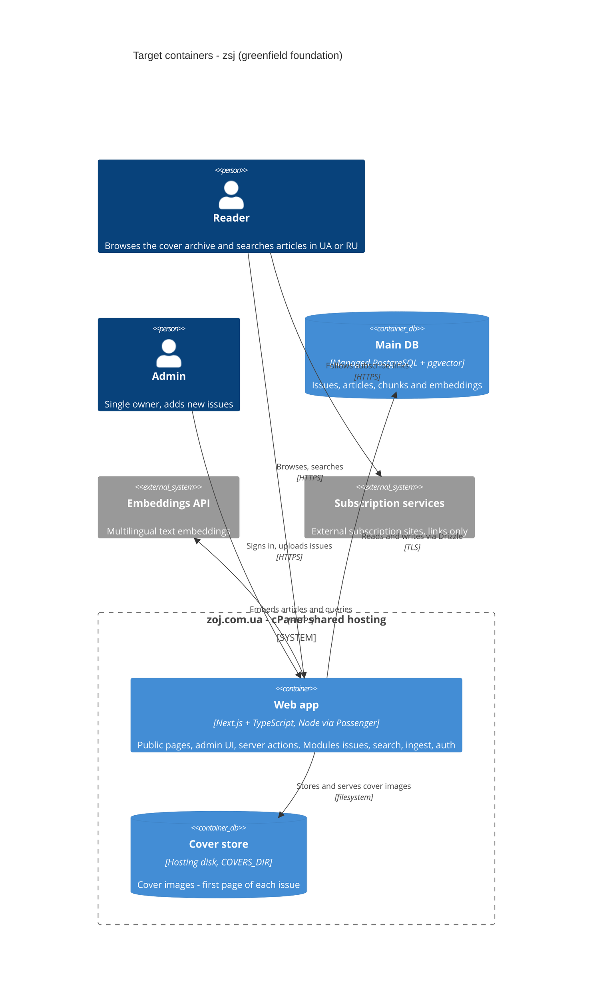

# Architecture map — zsj

> **Target foundation** (greenfield bootstrap) for the new bilingual (UA/RU) website of the
> «Здоровий спосіб життя» (ЗСЖ) newspaper at `zoj.com.ua`, produced by `survey` from
> `docs/idea-brief.md` and the foundation session of 2026-11-25. Nothing is built yet: the C4 and
> module inventory describe what `/sdd:scaffold` materializes, and the conventions are the rules every
> feature follows. Paths below are **target paths** — they resolve once scaffold has run. Refresh
> with `survey` after the skeleton exists (the mode then flips to `current`).

## Stack

- Language / runtime: TypeScript (strict) on Node.js ≥ 22 — the exact major is whatever the cPanel Node selector offers, pinned in `package.json` `engines` and `.nvmrc` ([ADR-0001](adr/0001-use-nextjs-typescript-single-app.md))
- Frameworks: Next.js (App Router, latest stable at scaffold time), `output: 'standalone'` — public pages, the admin UI and server-side logic in one app ([ADR-0001](adr/0001-use-nextjs-typescript-single-app.md))
- i18n: `next-intl`, locales `uk` (default) and `ru`, prefix on every public URL (`/uk/…`, `/ru/…`) ([ADR-0005](adr/0005-prefix-every-public-url-with-locale.md))
- Datastore: managed PostgreSQL with the `pgvector` extension (e.g. Neon) ([ADR-0002](adr/0002-use-managed-postgres-with-pgvector.md))
- DB access + migrations: Drizzle ORM + drizzle-kit, SQL migrations in `drizzle/` ([ADR-0002](adr/0002-use-managed-postgres-with-pgvector.md))
- Embeddings: an external multilingual embeddings API (default candidate: OpenAI `text-embedding-3-small`) behind an `Embedder` port ([ADR-0003](adr/0003-use-external-embeddings-api-behind-port.md))
- Code organization: feature modules `src/modules/<module>/{domain,application,infra}` with thin `src/app/` routes ([ADR-0004](adr/0004-organize-code-as-feature-modules.md))
- UI: Tailwind CSS + shadcn/ui primitives
- Admin auth: one password, scrypt hash in `ADMIN_PASSWORD_HASH` (env), encrypted httpOnly session cookie via `iron-session`
- Tests: Vitest; integration tests against PGlite (in-process WASM PostgreSQL with pgvector — no Docker needed); Playwright E2E arrives with the first real pages
- Lint / format: ESLint (flat config, `typescript-eslint`, Next plugin) + Prettier; `tsc --noEmit` as the vet step
- Package manager: npm
- Build / test / lint commands: `npm run build` (next build) · `npm test` (vitest run) · `npm run lint` (eslint) · `npm run typecheck` (tsc --noEmit) · `npm run db:generate` / `db:migrate` / `db:down`
- CI / CD: GitHub Actions (remote `github.com/pashaprig/zsj`) — CI (lint + typecheck + test + build) in the skeleton; the deploy workflow (build standalone → apply migrations → rsync over SSH → Passenger restart) is added once Node on the hosting is confirmed

## C4 — system as it is

Target baseline: what scaffold plus the first features build. Nothing below exists yet.

## Module inventory

Target modules (scaffold creates each with an empty public `index.ts`; features fill them).

| Module | Path | Layers | Wired at | Responsibility |
|---|---|---|---|---|
| issues | `src/modules/issues/` | domain/application/infra | `src/modules/issues/index.ts` | Issues (number, date, language, cover) and their articles; archive and issue reads |
| search | `src/modules/search/` | domain/application/infra | `src/modules/search/index.ts` | Semantic article search over pgvector, with the UA→RU language fallback rule from the brief |
| ingest | `src/modules/ingest/` | domain/application/infra | `src/modules/ingest/index.ts` | Admin flow: create an issue, store the cover, take article text (PDF/Word), chunk, embed, index |
| auth | `src/modules/auth/` | domain/application/infra | `src/modules/auth/index.ts` | Admin password check + session; guards `/admin` |
| shared kernel | `src/shared/` | — | imported directly | `env` (zod-validated config), `errors`, `ids` (UUIDv7), `db` (Drizzle client + schema barrel), `embeddings` (`Embedder` port + adapters) |
| web routes | `src/app/` | ports (UI) | `src/app/[locale]/layout.tsx`, `src/app/admin/layout.tsx` | Thin pages, server actions and route handlers that call module `index.ts` only |
| UI kit | `src/components/` | ui | `src/components/ui/` (shadcn) | Shared primitives + composed components |

## Conventions (cited — the rules a new feature must match)

Target paths; scaffold creates the cited files.

- **Module wiring / registration:** each module exposes its public API only through `src/modules/<m>/index.ts`. Routes and other modules import from that barrel, never from `domain/`, `application/` or `infra/` directly (enforced by an ESLint `no-restricted-imports` rule in `eslint.config.mjs`). Dependencies are wired by plain factory functions in `index.ts`, with no DI container.
- **Layering inside a module:** `domain/` holds pure types and rules (no I/O, no Next.js, no Drizzle). `application/` holds use-case functions that take ports as arguments. `infra/` holds the Drizzle repositories and external adapters. Next.js-specific code (`next/*`, server actions, `cookies()`) lives only in `src/app/`.
- **Error handling:** typed domain errors in `src/shared/errors/` (`NotFoundError`, `ValidationError`, `UnauthorizedError`, base `AppError` with a `code`). Route handlers map them to the JSON envelope `{ "error": { "code": string, "message": string } }` with the matching HTTP status. Pages map `NotFoundError` to `notFound()`. Never leak stack traces or raw DB errors.
- **IDs:** UUIDv7 generated by the app (`src/shared/ids/`), stored as `uuid`. Public URLs use human-readable slugs (e.g. `/uk/archive/2026-03`), never raw ids.
- **Persistence / DB access:** only `src/modules/*/infra/` touches Drizzle. The schema is split per module (`src/modules/<m>/infra/schema.ts`) and re-exported by `src/shared/db/schema.ts`. The DB is dumb storage, so business rules live in `domain/`.
- **Migrations:** drizzle-kit generates forward SQL into `drizzle/NNNN_<name>.sql` (`npm run db:generate`) and applies it with `npm run db:migrate`. drizzle-kit has no down migrations, so every migration gets a hand-written pair `drizzle/down/NNNN_<name>.down.sql`, applied by `npm run db:down`. The first migration enables `CREATE EXTENSION IF NOT EXISTS vector`. Migrations run in CI/CD before deploy, never at app boot.
- **Tests:** Vitest. Unit tests sit beside the code as `*.test.ts`. Integration tests are `*.int.test.ts` and get a fresh PGlite DB with all migrations applied (helper `tests/helpers/db.ts`). The `Embedder` is replaced by a deterministic fake (`tests/helpers/fake-embedder.ts`), so tests never call the network. The smoke test lives in `tests/smoke.test.ts`.
- **Inter-module communication:** direct synchronous calls through the other module's `index.ts`. No events or queue: the volume is 12–24 issues a year.
- **Config / secrets:** every env var is declared and validated once in `src/shared/env/` (zod) and read only through that module. `.env.example` lists them all. Secrets live in cPanel env vars and GitHub Secrets, never in git.
- **i18n:** UI strings are only in `messages/uk.json` and `messages/ru.json` (next-intl), with routing config in `src/i18n/`. Content language (`uk` | `ru`) is a field on issues and articles, independent of the UI locale.
- **UI / styling:** Tailwind utility classes and shadcn/ui primitives from `src/components/ui/`. No second styling approach (no CSS-in-JS, no ad-hoc CSS files beyond `src/app/globals.css`). Details are in §Frontend / UI foundation.

## Datastores

| Store | Engine | Accessed via | Notes |
|---|---|---|---|
| main DB | PostgreSQL + pgvector (managed, e.g. Neon) | Drizzle ORM, only from `src/modules/*/infra/` | issues, articles, article chunks + embeddings. Connection string in `DATABASE_URL` |
| test DB | PGlite (in-process, `vector` extension) | same Drizzle schema + migrations | fresh per integration test file; never used in production |
| cover store | hosting disk, directory `COVERS_DIR` outside the deploy dir | `CoverStorage` port in `src/modules/ingest/infra/` | ~100–300 KB per cover, ≤ 48 covers/year; the deploy must not wipe it |

## Frontend / UI foundation

Target, created by scaffold. There is no existing UI to reuse yet, so the first UI features establish the precedents below.

- **Component library / design system:** shadcn/ui, copied into `src/components/ui/` (owned code). Composed project components go in `src/components/`. Consider `/sdd:design-system` before the first UI feature.
- **Design tokens:** CSS variables in `src/app/globals.css` (shadcn theme: colors, radius), consumed through the Tailwind config.
- **Styling approach:** Tailwind CSS only.
- **Shared primitives:** whatever scaffold adds (at least `Button`), extended via `npx shadcn add <component>` instead of being written from scratch.
- **State / data-fetching:** React Server Components read data through module `index.ts` on the server. Mutations go through server actions. No client-side data-fetching library unless a feature justifies one.
- **Closest UI precedent:** none yet. The scaffold home page `src/app/[locale]/page.tsx` is the first one.

## Where things live / closest precedents

- A new public page → `src/app/[locale]/<route>/page.tsx`. Its strings go in `messages/{uk,ru}.json`, and its data comes from a module's `index.ts`.
- A new admin page → `src/app/admin/<route>/page.tsx`. The admin UI is Ukrainian-only and outside the locale prefix, protected by the auth guard in `src/app/admin/layout.tsx` + `src/proxy.ts` (or `middleware.ts` on older Next).
- New business logic → a use case in `src/modules/<m>/application/`, with a unit test beside it and an integration test if it touches the DB.
- A new table → `src/modules/<m>/infra/schema.ts`, then `npm run db:generate`, then a hand-written `drizzle/down/…down.sql`.
- A new external service → a port (interface) in the consuming module or in `src/shared/`, an adapter in `infra/`, and a fake in `tests/helpers/`.

## Constraints & known tech-debt

- **Hosting (unverified):** webcraft.ua shared hosting, tariff HS-300M, domain `zoj.com.ua`. The foundation assumes the tariff runs a Node.js app via cPanel «Setup Node.js App» (Passenger). If it doesn't, the owner moves to hosting that runs Node (owner decision 2026-11-25). The code doesn't change, only the deploy workflow does. Verify before writing the deploy workflow.
- **Memory on shared hosting:** the runtime must stay light. No local ML models (ADR-0003), no in-process vector scans, and no `next build` on the hosting (the build runs in GitHub Actions).
- **Storage:** article content is stored as text only. The only image kept per issue is the cover (first page). Full issue PDFs are **not** retained (owner decision 2026-11-25). How the admin's PDF yields its text and cover (in-browser pdf.js vs. server-side parsing; OCR if a PDF has no text layer) is a `design` decision for the ingest feature, and `idea-brief.md` §8 still holds the open check on the PDF text layer.
- **Budget:** extra services ≤ 500–1000 UAH/month. That covers the Neon free or Launch tier and embeddings costs well under $1/year at 12–24 issues/year.
- **Free-tier DB cold start:** Neon's free tier suspends when idle, so the first query after a pause takes ~0.5–1 s longer. This is acceptable at launch, and the paid tier removes it.
- **No Docker locally:** integration tests use PGlite, so PGlite-vs-Neon differences (extension versions) are caught only by the post-deploy smoke check.

## Reconciliation with the authored architecture doc

There is no authored architecture doc, so this map is the current reference. The source of intent is `docs/idea-brief.md`. This map resolves its open hosting question by assumption (Node available, confirm before deploy) and its storage risk by owner decision (text + cover only).
