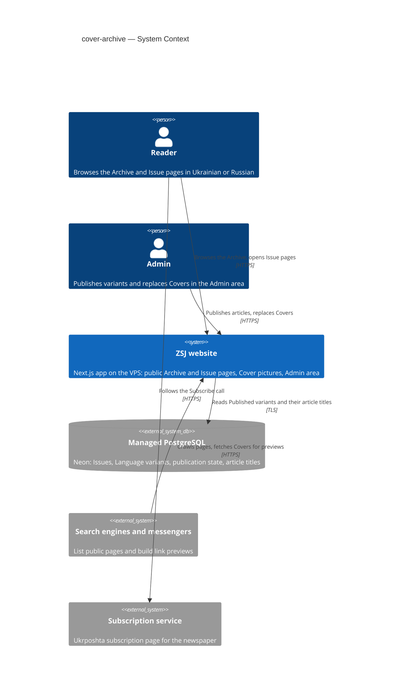
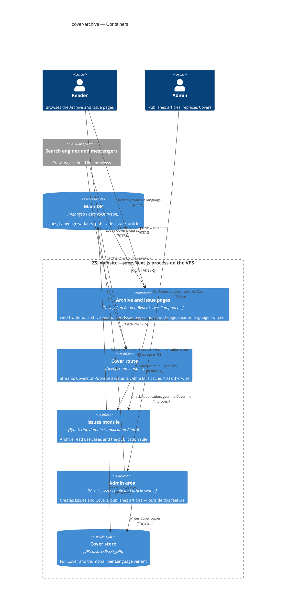
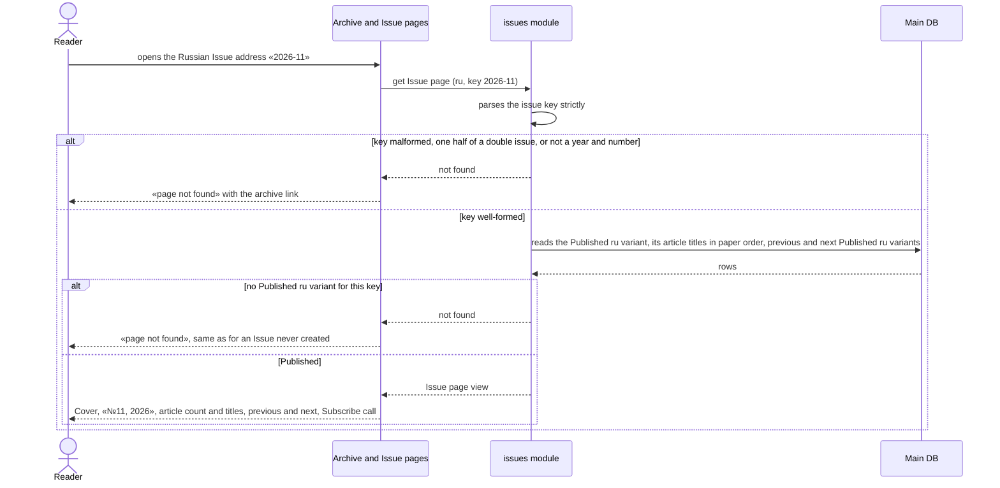
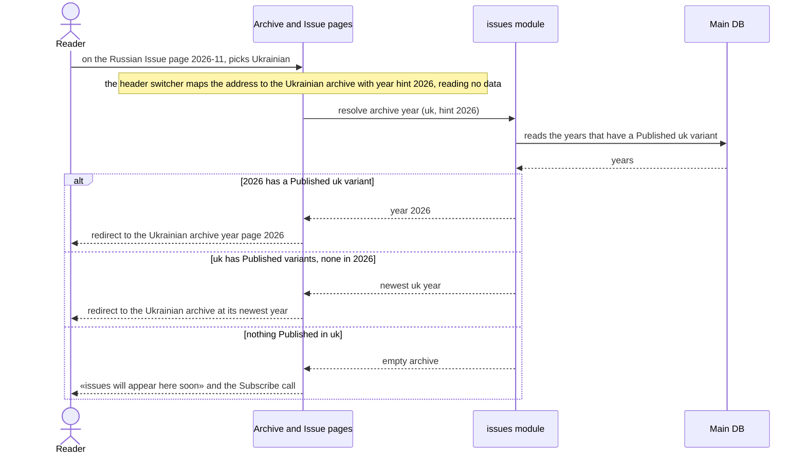

# Software Architecture Document — cover-archive

> **Upstream:** [spec.md](spec.md) · [ux-flows.md](ux-flows.md) · [CONTEXT (project)](../../../CONTEXT.md) · [architecture map](../../architecture-map.md) · project ADRs [0001](../../adr/0001-use-nextjs-typescript-single-app.md), [0002](../../adr/0002-use-managed-postgres-with-pgvector.md), [0004](../../adr/0004-organize-code-as-feature-modules.md), [0006](../../adr/0006-ukrainian-at-root-russian-under-ru.md).

## 1. Introduction and goals

**Intent.** Each language version of the site gets its own public Archive of Published variants, shown one year per page as Cover tiles with number and year, and an Issue page for every Published variant: its full Cover, «№11, 2026», the number of articles and all article titles in the paper's order, links to the previous and next issue of the same language, a way back to the archive at the issue's year, and the Subscribe call. The feature is read-only for Readers: it adds server-rendered pages and a public Cover delivery to the existing Next.js app, reads everything through the `issues` module, and writes nothing. Whatever the Admin publishes (article-search) or replaces (issue-create) shows up here without a separate step.

**Top-3 quality goals (1-liners; full scenarios in §10):**

1. **Visibility correctness** — only Published variants of the page's language ever appear, on pages and as Cover pictures; an unpublished variant is indistinguishable from a missing one, and no page hints whether the other language has a variant.
2. **Speed** — archive year page and Issue page each p95 ≤ 500 ms (600 Issues in the database; a variant with 100 articles).
3. **Light on phones** — archive year page ≤ 1.6 MB and Issue page ≤ 450 KB transferred, every page usable at 360 px wide.

**Stakeholders.**

| Role | Interest | Sign-off owner? |
|---|---|---|
| Reader | Browses the Archive of their language, opens Issue pages, shares them, follows the Subscribe call | No |
| Admin | Adds Issues in the Admin area; a variant appears in the Archive the moment its articles are published, and a replaced Cover shows within a minute — with no extra step. As the site's single owner (Pavlo), also approves this SAD and builds the feature | Yes |

The project has exactly these two roles (CONTEXT glossary); there is no separate Tech Lead or Security Lead.

- **Decision override: the «page not found» page is built at step 4 but stays owned by article-search** — ux-flows SCR-03 and article-search AC-07 name article-search as its owner, yet the archive needs the page at step 4 (spec AC-03, AC-06, AC-07). cover-archive builds a minimal localized version with the archive link; article-search keeps ownership and completes it (the search link) at step 5 — rationale: build order, not a change of owner (critic, 2026-11-28).

## 2. Constraints

**Technical.**
- TypeScript (strict) on Node.js ≥ 22 ([ADR-0001](../../adr/0001-use-nextjs-typescript-single-app.md)).
- Next.js 16.4 App Router with `output: 'standalone'`, React 19.3, next-intl 4.16 (`uk` at the root, `ru` under `/ru`, no locale detection — [ADR-0006](../../adr/0006-ukrainian-at-root-russian-under-ru.md)); Tailwind CSS 4.3 + shadcn/ui.
- Managed PostgreSQL + pgvector (Neon) through Drizzle ORM 0.45 / drizzle-kit 0.31 ([ADR-0002](../../adr/0002-use-managed-postgres-with-pgvector.md)); tests on PGlite 0.6.
- Covers live as files on the VPS disk under `COVERS_DIR`, written by issue-create; the site keeps no PDF (architecture map §Constraints).
- One Next.js process behind nginx on a small VPS (1 vCPU, 1 GB RAM target); no `next build` on the server; Neon free tier may add a 0.5–1 s cold start after idle.
- Feature modules `src/modules/<m>/{domain,application,infra}` with a public `index.ts`; Next.js APIs only in `src/app/` ([ADR-0004](../../adr/0004-organize-code-as-feature-modules.md)).

**Organisational.**
- One developer — the Admin, i.e. the site's owner (learning while building, test-first); no launch deadline.
- Roadmap step 4: built after issue-create (step 3) and before article-search (step 5); checked at step 4 with sample Published variants seeded in tests; goes live together with search (roadmap, Decisions so far). AC-09 on article pages, AC-10, and the search link that the «page not found» page offers in AC-03 and AC-06 are checked at step 5 (the archive link is checked at step 4).
- This SAD is written before the issue-create and article-search SADs; the Issue / Language variant / Cover model and the publish action are theirs (§5 lists what the archive reads from them).

**Conventions.**
- [CLAUDE.md](../../../CLAUDE.md) and [architecture map §Conventions](../../architecture-map.md#conventions-cited--the-rules-a-new-feature-must-match).
- Errors: `NotFoundError` from `src/shared/errors`; pages map it to `notFound()`. IDs: UUIDv7 internally; public addresses use the readable issue key («2026-11», «2026-07-08»), never an id.
- UI strings only in `messages/uk.json` + `messages/ru.json`; public links through `Link` from `@/i18n/navigation`.
- The locale middleware matcher (`src/proxy.ts`) excludes non-page prefixes (`api`, `admin`, …); this feature adds `covers` so the Cover route is not routed into `[locale]`.

**Regulatory / external.**
- Public data only — Covers, numbers and article titles of Published variants; no personal data is asked for or kept (spec §6.1).
- Security review: N/A per spec §6.1 — read-only public pages, no new sign-in boundary, no input beyond the page address; Cover storage and upload are reviewed with issue-create.

## 3. Context and scope

The ЗСЖ website shows Readers, on the Ukrainian and the Russian version of the site, what the paper has published: an Archive of Covers per language and year, and an Issue page per Published variant that leads into its articles, to neighbouring issues and to the Subscribe call. The Admin never acts in this feature — publishing articles (article-search) and replacing Covers (issue-create) happen in the Admin area and simply change what these pages show. Search engines and messengers read the same public pages to list them and to build link previews.

<!-- brownfield: scaffold skeleton only — Next.js app with locale layout, header with a path-keeping language switcher, info pages; modules issues/search/ingest/auth are empty barrels; no tables yet (drizzle/0000_init.sql enables pgvector). Architecture map reflects 02dedb2 (pre-scaffold) — run `/sdd:survey` to refresh. -->

**External systems (in / out):**

| Actor or system | Type | Interaction |
|---|---|---|
| Reader | Person | Browses the Archive by year, opens Issue pages, switches language, shares addresses, follows the Subscribe call |
| Admin | Person | Publishes a variant's articles and replaces Covers in the Admin area (issue-create, article-search); no action in this feature |
| Managed PostgreSQL (Neon) | System (external) | Holds Issues, Language variants, the publication state and article titles the pages read |
| Search engines and messengers | System (external) | Crawl archive year pages and Issue pages; fetch the Cover, the paper's name and «№11, 2026» for link previews |
| Subscription service (Ukrposhta) | System (external) | Target of the Subscribe call once the Admin names its address; until then the site's «Subscription» page |

**C4 Context (L1):**



## 4. Solution strategy

**Target surface: `web-frontend`** — the feature is HTML pages and Cover pictures served by the existing Next.js app to browsers, search engines and messengers; there is no separate API and no client-side data fetching, so no `backend-service` contract is authored here. **UI architecture:** server-rendered with React Server Components, rendered per request (ADR-0001); the only client component is the header language switcher (ADR-0003). It reuses the repo's UI foundation (Tailwind + shadcn/ui primitives in `src/components/ui/`, tokens in `src/app/globals.css`); screen-level design is deferred to the design canon and `screens`.

**Top strategic choices (the seeds for ADRs):**

1. **Render per request, no page cache** ([ADR-0001](adr/0001-render-archive-pages-per-request-without-page-cache.md)) — every archive and Issue page asks the database what is Published right now, so publishing, re-publishing and replacing a Cover need no cache invalidation anywhere (quality goal 1), and the small data volume keeps each render within the 500 ms budget (quality goal 2). Each archive route opts out of Next.js static rendering explicitly.
2. **One publication rule in the `issues` module, applied to pages and Cover pictures alike** ([ADR-0002](adr/0002-serve-public-covers-through-an-app-route-with-60-second-cache.md)) — the `issues` module owns the read model (Issue, Language variant, Cover reference, publication marker, article titles in paper order — architecture map §Module inventory) and a single «Published variant of language L» rule: defined in `issues/domain`, executed by exactly one reusable SQL condition in `issues/infra` that every archive query and the Cover route use. Pages filter by it in their queries; a public Cover route checks it before streaming the file with a 60-second cache, so an unpublished variant is a 404 everywhere and a replaced Cover shows within a minute.
3. **Language switch through a year hint on the archive** ([ADR-0003](adr/0003-switch-language-through-a-year-hint-on-the-archive.md)) — the header switcher maps Issue, article and archive year addresses to `<other language>/archive?year=YYYY` without reading data; the archive root resolves the hint to that year, the newest year or the empty archive. Nothing on a page points from one Language variant to the other (spec AC-08, AC-09).
4. **Readable, strictly parsed addresses** — `/archive` (newest year; optional `year` hint), `/archive/2026` (year page), `/archive/2026-11` and `/archive/2026-07-08` (Issue page), with Russian under `/ru` (ADR-0006); article pages nest under the issue key (article-search AC-18 confirms the rest). One dynamic segment is parsed by a domain function into «year» or «issue key»; anything else — a number without two digits, one half of a double issue, non-consecutive numbers, text — is «page not found» before any query runs.

Each tactical decision in later sections should trace to one of these seeds. Tactical decisions that *contradict* a strategic choice are red flags — surface them in §11.

## 5. Building block view

The feature follows the repo's layered feature-module style (ADR-0004): pure rules in `issues/domain` (issue-key parsing and formatting, the sort key «year, higher number», the definition of a Published variant), read use cases in `issues/application` that receive a repository port, the Drizzle read repository with the one SQL form of the publication rule and the Cover file reader in `issues/infra` (placing the reader in `issues` is an assumption until issue-create's design decides which module owns Covers — §11), and thin Next.js pages and a route handler in `src/app/` that import only `@/modules/issues`. It adds no module and writes nothing; Issues, Language variants and Covers are created by issue-create, and the publication marker and articles by article-search.

**Internal decomposition:**

```
src/modules/issues/
├── domain/        issue key (parse/format «2026-07-08», «№7–8, 2026»), sort key, Published-variant definition, archive view types
├── application/   listArchiveYear, resolveArchiveYear (hint → year | newest | empty), getIssuePage (incl. previous/next), getPublicCover
├── infra/         publishedIn(language) — the single SQL condition of the rule; archive read repository (Drizzle); Cover file reader over COVERS_DIR (assumed here, §11)
└── index.ts       public API: the four use cases wired to infra, the issue-key helpers
src/app/[locale]/archive/
├── page.tsx       archive root: newest year, year-hint redirect, empty archive
└── [key]/page.tsx year page or Issue page by the shape of the key (article pages nest here at step 5)
src/app/[locale]/not-found.tsx   site-wide «page not found» in the site's language — minimal step-4 version with the archive link; owned and completed by article-search (§1 override)
src/app/covers/[lang]/[key]/[size]/route.ts   public Cover route (outside locale routing)
src/proxy.ts       matcher adds `covers` to the excluded prefixes
src/components/    issue-tile, year-switcher, subscribe-call, language-switcher (changed)
```

**Read contract the archive expects from upstream features** (input to the issue-create and article-search designs; columns are `data-model`'s job):

| Data | Owner (writer) | What the archive reads |
|---|---|---|
| Issue | issue-create | year; one number or two consecutive numbers; Publication = the newspaper |
| Language variant | issue-create | language (`uk` / `ru`); its Issue; a Cover findable by (language, issue key, size `full` / `thumb`), replaced in place |
| Publication marker | article-search (publish) | whether the variant is Published, set in the same transaction that makes its articles readable |
| Article | article-search | its variant, its position in the paper, its title, its address slug |

**C4 Container (L2):**



## 6. Runtime view

**Critical flow 1: open an Issue page** (AC-05, AC-06, AC-07)



**Critical flow 2: switch language from an Issue page** (AC-09, ADR-0003)



The archive year page, the year switcher, the Cover route and the empty archive are drawn by the `sequences` stage.

## 7. Deployment view

No new deployment unit: the pages and the Cover route run in the one Next.js process (standalone build, systemd) behind nginx on the VPS planned for roadmap step 6, reading the managed PostgreSQL and the `COVERS_DIR` directory that issue-create already uses. The only configuration change is a new `SITE_URL` variable (declared in `src/shared/env` and `.env.example`) so link previews and the alternate-language hints carry absolute addresses.

**Monitoring:**
- Response time per request from nginx's access log (`$request_time`, page path only) — the «server timing» measurement in spec §6, checked in the first week after launch.
- Uptime check on an archive year page and one Issue page (spec §6 availability), set up with the deploy.
- No new application logs; errors follow the repo convention (no stack traces to Readers).

**Scaling thresholds:**
- Comfortable as designed at the spec's scale: ~600 Issues (≈ 1 200 variants) and ~100 articles per variant — a year page reads ≤ 24 variants, an Issue page ≤ ~100 titles.
- If p95 of either page exceeds 500 ms on the VPS in the first week (cold starts excluded), or crawler traffic makes database reads a visible cost, move to tag-cached reads (ADR-0001 option 3).
- If Cover requests dominate the Node process, move byte transfer to nginx (ADR-0002 option 2).

## 8. Crosscutting concepts

| Concept | Convention | Where defined |
|---|---|---|
| Visibility | The «Published variant of language L» rule is defined in `issues/domain` and executed by one reusable SQL condition `publishedIn(language)` in `issues/infra`; every archive query, previous/next, the year list and the Cover route use that condition, never a copy and never post-filtering; QG-1 integration tests pin it to the rule | here (ADR-0002) |
| Error handling | A malformed key or a non-Published variant raises `NotFoundError`; pages map it to `notFound()` → `src/app/[locale]/not-found.tsx`; the Cover route answers 404 via `toErrorResponse`; nothing from the address is echoed into the page | CLAUDE.md §Conventions |
| Addresses / IDs | Issue key «YYYY-NN» or «YYYY-NN-NN» (consecutive numbers), year «YYYY»; strict parse in `issues/domain`; never an internal id; one address per page | CLAUDE.md, here §4 |
| Internationalisation | UI strings only in `messages/uk.json` + `messages/ru.json`; on the archive the page locale selects the content language 1:1; «№7–8, 2026» formatted by one domain function shared with the Admin list (issue-create AC-07) | CLAUDE.md §i18n |
| Search engines / previews | `generateMetadata`: title and Open Graph image (absolute full Cover address) in the variant's language; archive year pages declare their counterpart year page only when that language has a Published variant there; Issue pages declare no other-language counterpart; all pages indexable; no sitemap in v1 | here (spec AC-11) |
| Images | Plain `` with width and height, no Next.js image optimizer (Covers arrive pre-sized from issue-create, and the optimizer costs memory on a 1 GB VPS); the first row of tiles loads eagerly, the rest with `loading="lazy"` | here (spec §6 page weight) |
| Caching | Pages: none (ADR-0001). Covers: `public, max-age=60` + ETag (ADR-0002) | ADRs |
| Authentication | None — public pages; the Admin area is untouched | admin-login |
| Shared UI | `IssueTile` (reused by search results, step 5, and the home page, step 7), `SubscribeCall` (leads to the «Subscription» page until the Admin's address is configurable — article-search §8), built from `src/components/ui/` primitives | here |
| Logging / observability | No new logs; request timing from nginx (§7) | architecture map |

## 9. Architecture decisions

| # | Title | Status | Section |
|---|---|---|---|
| 0001 | Render archive pages per request without a page cache | Accepted | §4 |
| 0002 | Serve public Covers through an app route with a 60-second cache | Accepted | §4 |
| 0003 | Switch language through a year hint on the archive | Accepted | §4 |

ADR files live under `docs/features/cover-archive/adr/NNNN-<title>.md`.

## 10. Quality requirements

**QG-1. Visibility correctness**
- **When:** a Reader lists the archive, opens an Issue address or a Cover picture address, or follows previous/next, while some variants are unpublished, missing or only in the other language (spec AC-07, AC-08).
- **Then:** only Published variants of the page's language appear as tiles, years, Issue pages, previous/next links and Covers; an unpublished variant's page and Cover give the same «page not found» as an Issue that never existed; no page names the other language's variant.
- **How verify:** integration tests on PGlite seeding Published, unpublished and other-language variants — assert tile lists, the year list and previous/next; assert that the unpublished and the never-created address give identical status and body, for pages and for the Cover route.

**QG-2. Speed**
- **When:** a Reader opens an archive year page, or an Issue page.
- **Then:** archive year page p95 ≤ 500 ms with 600 Issues in the database; Issue page p95 ≤ 500 ms for a variant with 100 articles (same as the article page, article-search §6).
- **How verify:** integration test with 600 seeded Issues timing the archive-year and Issue-page reads; server timing on archive and Issue page requests (nginx request time) in the first week on the VPS.

**QG-3. Light on phones**
- **When:** a Reader on a phone opens an archive year page with 24 issues, or an Issue page.
- **Then:** archive year page ≤ 1.6 MB transferred for a year of 24 issues, Covers included (thumbnails ≤ 60 KB each, issue-create §6); tiles below the first screen load only when scrolled to. Issue page ≤ 450 KB transferred, the full Cover included (≤ 300 KB, issue-create §6). Every archive and Issue page usable at 360 px wide with no sideways scrolling; at least 2 tiles per row.
- **How verify:** browser network panel on the integration environment, phone profile; e2e check at 360 px.

**QG-4. Freshness of a replaced Cover**
- **When:** the Admin replaces the Cover of a Published variant (issue-create AC-08).
- **Then:** ≤ 1 min until the archive and Issue page show the new Cover.
- **How verify:** integration test — after a replacement the Cover route returns the new bytes with `max-age` ≤ 60 and a new ETag; manual check on the VPS.

Availability is inherited from all public pages: 99% monthly, verified by the uptime check on the VPS (§7).

## 11. Risks and technical debt

| Risk / debt | Severity | Mitigation | Owner |
|---|---|---|---|
| Next.js renders an archive route statically because it sees no dynamic API, freezing the archive so new publications never appear | High | Every archive route and the Cover route opt out of static rendering explicitly (ADR-0001); an integration test renders, publishes another variant and renders again | Pavlo |
| This SAD is written before the issue-create and article-search SADs; their models may not give the archive what §5 «Read contract» expects (Cover by language + key + size, publication marker set with the articles, article position and slug) | Medium | §5 read contract is an input to `/sdd:design issue-create` and the article-search design; cover-archive's `data-model` reconciles with whatever exists when it runs | Pavlo |
| Neon free-tier cold start (0.5–1 s after idle) pushes page p95 over 500 ms | Medium | Accepted at launch (architecture map §Constraints); measured in the first week; Neon paid tier or tag-cached reads (ADR-0001 option 3) if breached | Pavlo |
| Which module owns Covers is still open (issue-create §8: `issues` or `ingest`, no default; architecture map §Datastores puts `CoverStorage` in `ingest/infra`); this SAD assumes the Cover file reader lives in `issues` | Medium | Resolved by `/sdd:design issue-create`; if Covers land in `ingest`, the `issues` read path gets the file through `ingest`'s public `index.ts` while the publication check stays in `issues` | Pavlo |
| The «page not found» page should offer search (spec AC-03, AC-06, article-search AC-07), but the search page arrives at roadmap step 5 | Low | Step 4 builds a minimal localized not-found page with the archive link; article-search, its owner, adds the search link (§1 override, §2 step-5 list) | Pavlo |
| Crawlers walking every year and Issue page, with up to 24 Cover requests each, load the Node process and the database | Low | Small pages, 60 s Cover cache + ETag; ADR-0002 option 2 or ADR-0001 option 3 if load shows (§7 thresholds) | Pavlo |
| The architecture map reflects the pre-scaffold commit `02dedb2`, and CLAUDE.md §Storage still says «one cover image per issue» | Low | Run `/sdd:survey` after issue-create is designed; issue-create updates CLAUDE.md §Storage (its §1 decision) | Pavlo |

**Accepted debt (acceptable in v1, plan to fix later):**
- No page or data cache — every view reads the database (ADR-0001).
- A language switch from an Issue, article or year page costs one redirect (ADR-0003).
- No sitemap — pages are reachable by links from the archive and by the alternate-language hints of year pages.

## 12. Glossary

| Term | Meaning |
|---|---|
| Archive | The public list of the Published variants of one language, one year per page, as Cover tiles with number and year; each language version of the site has its own (CONTEXT) |
| Archive year page | One page of the Archive: the Published variants of one language in one year, with the year switcher; address `/archive/2026` (proposed for CONTEXT) |
| Issue | One release of the newspaper identified by year and number(s) — a double issue holds two consecutive numbers; up to two Language variants (CONTEXT) |
| Issue page | The public page of one Published variant: Cover, number and year, article titles in paper order (CONTEXT) |
| Issue key | The readable address part naming an Issue: year and two-digit number(s), «2026-11», «2026-07-08»; never an internal id (proposed for CONTEXT) |
| Language variant | The Ukrainian or Russian version of an Issue, with its own Cover (CONTEXT) |
| Published variant | A Language variant whose articles the Admin has published; the only kind Readers ever see (CONTEXT) |
| Cover | The front-page image of one Language variant; Readers get a full Cover and a thumbnail (CONTEXT) |
| Cover tile | An archive entry: the variant's Cover thumbnail with «№11, 2026», opening its Issue page; reused by search results and the home page (proposed for CONTEXT) |
| Year hint | The `year` parameter the language switcher puts on the other language's archive address; the archive resolves it to that year, its newest year or the empty archive (internal, ADR-0003) |
| Subscribe call | The link that invites the Reader to subscribe to the print edition (CONTEXT) |
| Reader / Admin | Anyone using the public site without signing in / the single owner who publishes content (CONTEXT) |

