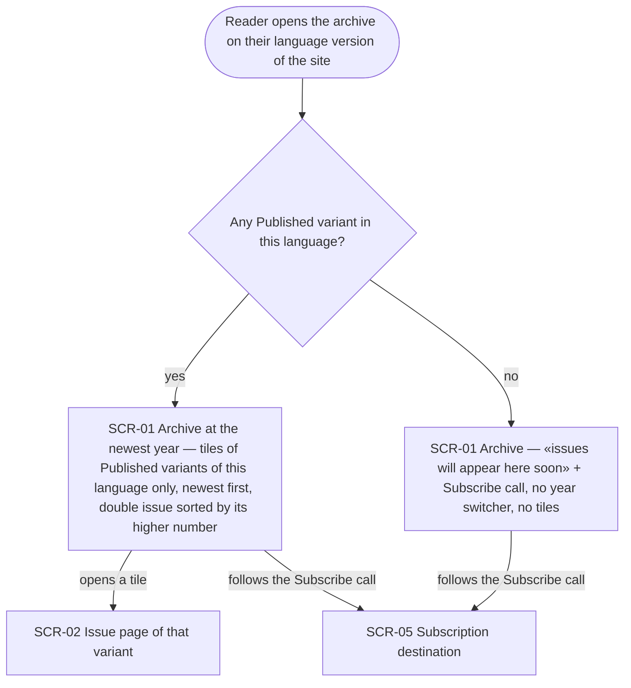
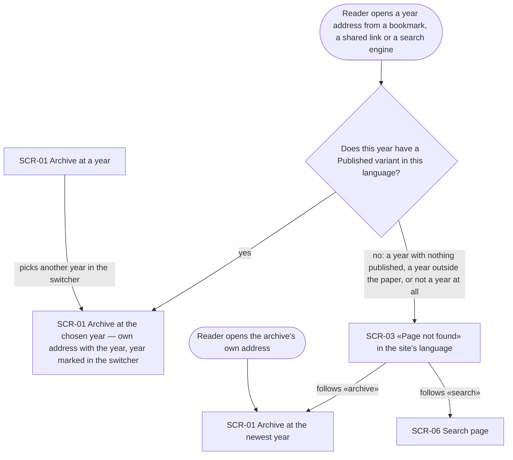
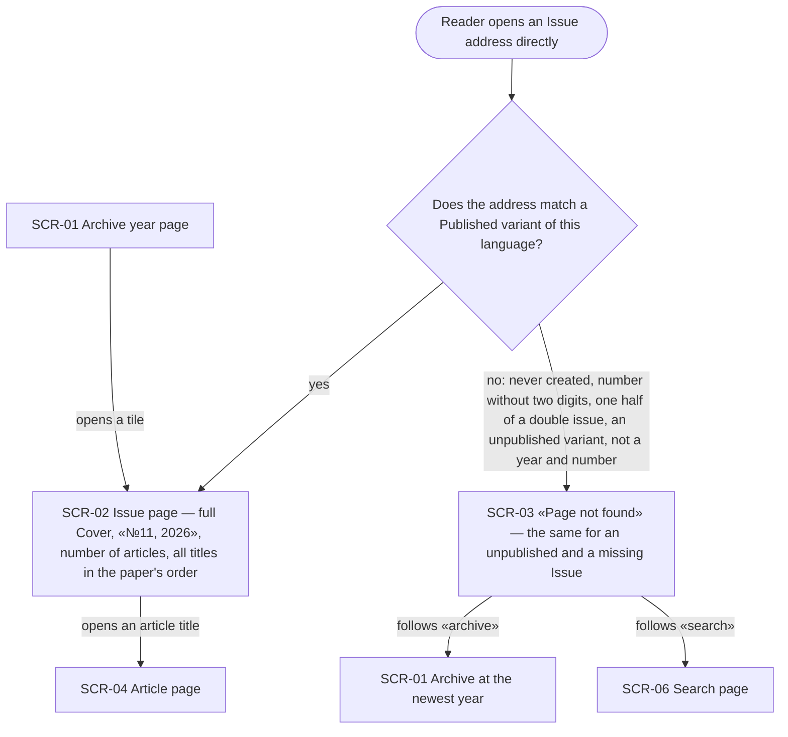
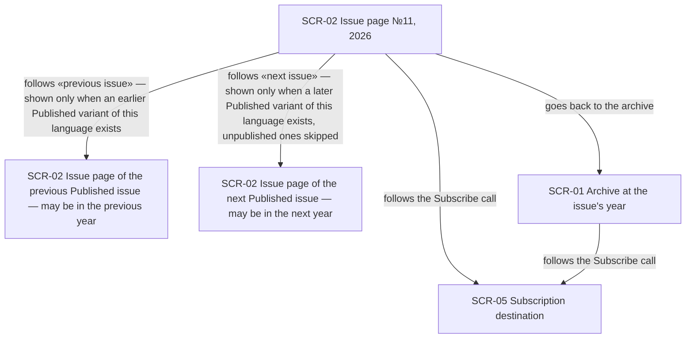
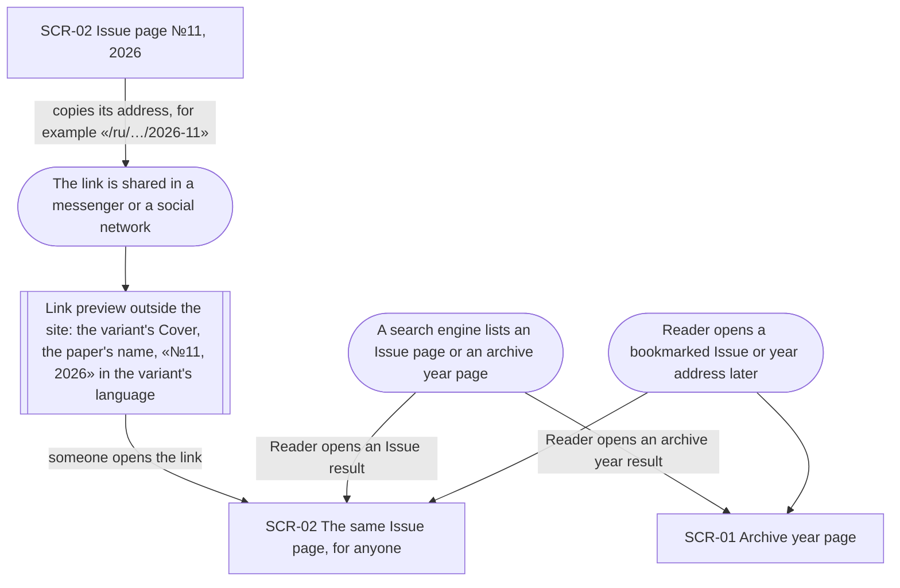
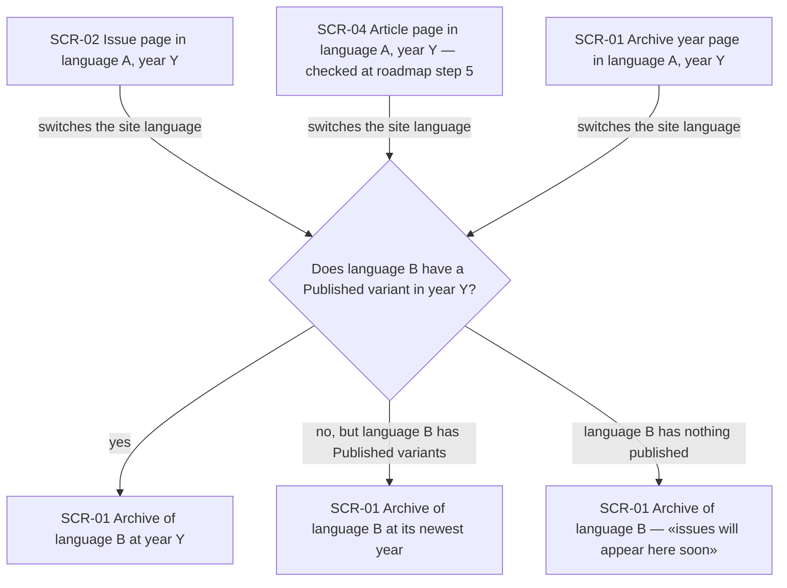

# UX flows — cover-archive

> User flows for every UI-touching §4 user story, produced by `ux-flows` (after `clarify`, before
> `design`) and read by `design` (evidence for the target-surface + UI-architecture decisions),
> `sequences` (UI-driven flows align on SCR ids), `screens` (details every inventory row) and
> `plan-tests` (the e2e-through-UI paths). **Always markdown + mermaid `flowchart`**, whatever the
> design tool — this artifact is flow-altitude, not visual design.

## Platform decisions

- **Posture:** mobile-first, responsive — `docs/design-system.md` does not exist yet (the owner builds the design canon last, for all features together); chosen here from spec §6: every page usable at 360 px with no sideways scrolling and at least 2 tiles per row. The design canon must confirm this posture or record a deviation.
- **One page per archive year.** The archive is navigated year by year, each year a page with its own address; the archive's own address always shows the newest year. No single endless page and no in-page filter (spec §1 decision, §3 non-goals).
- **The Issue page is a full page, not a dialog over the archive** — it needs its own stable address to be shared, bookmarked and listed by search engines (AC-11).
- **Wrong or hidden addresses lead to the site-wide «page not found» page** (owned by article-search, AC-07 there), never to an in-archive message and never to a different Issue (AC-03, AC-06, AC-07).
- **The language switch on an Issue page or an article page leads to the other language's archive, never to a counterpart Issue page** (spec §1 decision, AC-09). *Design input:* the current switcher keeps the page path, so it has to change for these pages — `design` decides how.
- **One language per page.** Every tile, title and previous/next link on a page belongs to the page's language; nothing hints at the other language's variant (AC-08).

## Screen inventory

| ID | Screen | Purpose | Entry | Exit |
|---|---|---|---|---|
| SCR-01 | Archive year page | The Published variants of one language and one year as Cover tiles (number + year), newest first; the year switcher (only years with something to show); the Subscribe call. With nothing published in this language yet: «issues will appear here soon» + the Subscribe call, no switcher | site navigation; the archive address (newest year) or a year address; a bookmark, shared link or search engine; «back to archive» on SCR-02; the language switch on SCR-01, SCR-02 or SCR-04; «archive» on SCR-03 | a tile → SCR-02; another year → SCR-01; the language switch → SCR-01 of the other language; the Subscribe call → SCR-05 |
| SCR-02 | Issue page | One Published variant: full Cover, «№11, 2026», the number of articles and all article titles in the paper's order; previous / next issue of the same language; back to the archive at the issue's year; the Subscribe call | a tile on SCR-01; previous / next on another SCR-02; a bookmark, shared link or search engine | an article title → SCR-04; previous / next → SCR-02; back → SCR-01; the language switch → SCR-01 of the other language; the Subscribe call → SCR-05 |
| SCR-03 | «Page not found» page | The site-wide not-found page in the site's language, offering the archive and search (owned by article-search, its AC-07) | a year address with nothing to show or that is not a year; an Issue address that does not match a Published variant of this language (including unpublished ones) | «archive» → SCR-01; «search» → SCR-06 |
| SCR-04 | Article page | Reading one Article (owned by article-search, its AC-06); in this feature only as a destination and as a language-switch start | an article title on SCR-02 | the language switch → SCR-01 of the other language (checked at roadmap step 5) |
| SCR-05 | Subscription destination | Where the Subscribe call leads: the external subscription service the Admin names, or until then the site's «Subscription» info page | the Subscribe call on SCR-01 or SCR-02 | leaves this feature |
| SCR-06 | Search page | Article search (owned by article-search); in this feature only as a destination from SCR-03 | «search» on SCR-03 | leaves this feature |

## Flows

### Flow: US-01 — Browse the covers of my language

The Reader opens the archive on the Ukrainian or Russian version of the site. If that language has at least one Published variant, they land on the archive at the newest year that has one: Cover tiles with number and year, newest first (a double issue such as №7–8 sorts by its higher number), only this language's Published variants — nothing unpublished and nothing from the other language. A tile opens that variant's Issue page; the Subscribe call leads to the subscription destination. If the language has nothing published yet, the archive says issues will appear here soon and shows only the Subscribe call — no year switcher, no empty tiles.

### Flow: US-02 — Move between years

On an archive year page the Reader picks another year in the switcher, which only lists the years that have a Published variant in this language, newest first; they land on that year's page, which has its own address with the year and marks the year in the switcher. The archive's own address always opens the newest year. Opening a year address from outside (a bookmark, a shared link, a search engine) shows the same year page when the year has something published; when it does not — an empty year such as 2023, a year the paper never had such as 1990 or 3000, or a word — the Reader gets the site's «page not found» page, which offers the archive (newest year) and search. The archive never shows an empty year.

### Flow: US-03 — Open an issue and see its articles

From a tile the Reader opens the Issue page: the full Cover, «№11, 2026», how many articles the issue carries and the titles of all of them in the order of the paper; each title opens its article page. Opening an Issue address directly leads to the same page only when it matches a Published variant of the page's language. Anything else — a number that was never created, a number written without its two digits, only one half of a double issue («2026-07» for №7–8), a variant whose articles are not published yet, or text that is not a year and number — gives the «page not found» page with the archive and search, never a different Issue; an unpublished variant looks exactly like a missing one. The Cover picture of an unpublished variant is not found either (no screen — the picture address alone).

### Flow: US-04 — Keep going through the paper

On an Issue page the Reader can step to the previous or the next issue of the same language. Each link points to the nearest Published variant in that direction, crossing year boundaries (the issue after the last one of 2025 is the first one of 2026), and skips variants that are not published; when there is none in that direction, the link is simply absent. «Back to the archive» returns to the archive at the issue's year, not the newest year. The Subscribe call is on both the Issue page and the archive and leads to the subscription destination.

### Flow: US-05 — Share an issue and find it from outside

Every Issue page has exactly one address on its language version, built from the year and the two-digit number(s) — «2026-11», «2026-03», «2026-07-08» for a double issue, never an internal number. The Reader copies it and shares it; the messenger or social network shows a preview with the variant's Cover, the paper's name and «№11, 2026» in the variant's language, and whoever opens it lands on the same Issue page. Search engines list Issue pages and archive year pages, so a Reader can arrive at either straight from a search result; a bookmark works the same way. Each archive year page also names its counterpart year page in the other language for search engines when that year has a Published variant there — a hint invisible to the Reader, so it has no step in the flow.

### Flow: US-06 — Switch language without losing my way

The Reader switches the site's language from an Issue page, an article page (checked at roadmap step 5, when article pages exist) or an archive year page. In every case they land on the other language's archive — never on the other language's variant of the same Issue, whether or not it exists. If the other language has a Published variant in the same year, they see that year; if not, its newest year; if it has nothing published at all, its «issues will appear here soon» archive. So the switch never reveals whether an Issue exists in the other language and never lands on a page that does not exist.

### Out of scope — not drawn

- **US-07 (Admin: see a published issue appear in the archive)** — the Admin's actions (publishing a variant's articles, replacing its Cover or its articles) happen on admin screens owned by article-search and issue-create; this feature has no screen of its own for them. Their effect on Readers is the «Published variant» condition already drawn in Flow US-01 (which tiles and years exist) and Flow US-03 (which Issue addresses open).

## AC coverage

| AC | Shown by | Notes |
|---|---|---|
| AC-01 | Flow US-01 → «yes» branch: SCR-01 at newest year → tile → SCR-02; Subscribe call → SCR-05 | Tile order and double-issue sorting are on the SCR-01 node; tile content is `screens`' job |
| AC-02 | Flow US-02 → switcher → SCR-01 at chosen year; year address from outside → «yes»; archive's own address → newest year | Switcher listing only years with something to show is on the edge label |
| AC-03 | Flow US-02 → «no» branch → SCR-03 → archive / search | Covers an empty year, a year outside the paper and a non-year |
| AC-04 | Flow US-01 → «no» branch → SCR-01 «issues will appear here soon» → SCR-05; Flow US-06 → «nothing published» branch | |
| AC-05 | Flow US-03 → tile → SCR-02 → article title → SCR-04; Flow US-04 → previous / next (crossing years, absent when none), back to archive at the issue's year, Subscribe call | |
| AC-06 | Flow US-03 → «no» branch → SCR-03 | Never a different Issue |
| AC-07 | Flow US-03 → «no» branch (unpublished variant = missing); Flow US-02 → «no» branch (a year only it would fill); Flow US-04 → next link skips unpublished; Flow US-01 → tiles of Published variants only | The Cover picture address has no screen — noted in Flow US-03 prose |
| AC-08 | Flow US-01 → «this language only» on SCR-01; Flow US-04 → previous / next of this language; Flow US-06 → never to the other language's variant | Pre-2022 Russian-only years simply have no Ukrainian year page — same «no» branch as Flow US-02 |
| AC-09 | Flow US-06 → all three branches, from SCR-02, SCR-04 and SCR-01 | Article-page start is checked at roadmap step 5 |
| AC-10 | Flow US-01 → «Any Published variant?» decision; Flow US-03 → «matches a Published variant?» decision | Cross-context: the publish / replace actions live in article-search and issue-create; checked at roadmap step 5. US-07 is not drawn (see Out of scope) |
| AC-11 | Flow US-05 → copy and share → link preview → SCR-02; search engine → SCR-02 / SCR-01; bookmark | The cross-language hint on archive year pages is invisible to Readers — named in the prose, no flow step |
