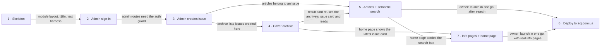

# Roadmap — zsj

> **A decomposition, not a promise.** The overall idea broken into incremental steps: what each
> step is, where it comes from, how big it is — or that nobody has looked at it yet — and in which
> order, and parallel lanes, we walk them. **No dates** (except shipped history), **no scores** —
> order is the prioritization. The *solution* for any step lives in its `docs/features/<slug>/`
> spec, not here.

## Destination

Readers of ЗСЖ in Ukrainian and Russian browse the cover archive on `zoj.com.ua`, find articles by meaning and follow through to subscription or to the advertising and editorial contacts, while the admin adds each new issue themselves and its articles become searchable.

## Steps

| # | Step | Source | Size | Status |
|---|---|---|:---:|---|
| 1 | Project skeleton with bilingual layout, language switcher and placeholder Advertising / Subscription pages (one paragraph and a placeholder link each; their content is step 7) — via `/sdd:scaffold` | `docs/architecture-map.md` §Stack; `docs/idea-brief.md` §7 Recommendation | S | shipped |
| 2 | Admin sign-in: one password, session, `/admin` closed to everyone else → [`features/admin-login/`](features/admin-login/) | `docs/idea-brief.md` §5 Out of scope (password-protected admin) | S | spec'd |
| 3 | Admin creates an Issue (year + number, double issues «№7–8», no month) and its Language variants (UA, RU — Russian only before 2022), each with its Cover; replaces a Cover; deletes while unpublished → [`features/issue-create/`](features/issue-create/) | `docs/idea-brief.md` §3 Users (Адмін) | M | spec'd |
| 4 | Reader browses the cover archive by language, one year at a time, and opens an Issue page (Cover, article titles in paper order, previous / next issue); the language switch leads to the other language's Archive, never to the same Issue's other variant → [`features/cover-archive/`](features/cover-archive/) | `docs/idea-brief.md` §7 Recommendation (public part) | S | spec'd |
| 5 | Article indexing and semantic search: admin uploads a Language variant's Word file, corrects the proposed split, tags every article and publishes; a reader's natural-language query returns excerpt + issue with cover + subscribe call (UA→RU fallback), each article has a public page with similar articles; also closes cover-archive AC-09 (article pages) and AC-10 → [`features/article-search/`](features/article-search/) | `docs/idea-brief.md` §2 Problem; §5 Out of scope (search language rule) | L | spec'd |
| 6 | Deploy to `zoj.com.ua`: GitHub Actions builds standalone, applies migrations, ships over SSH, restarts the app's service on the VPS (nginx in front) | `docs/idea-brief.md` §5 Out of scope (domain and hosting); `docs/architecture-map.md` §Constraints & known tech-debt | S | idea |
| 7 | Info pages and home page (`site-pages`): Subscription (subscription indexes for each language, the Ukrposhta link), Advertising (contact for advertisers) and Contacts (editorial office), with real content in both languages; the home page shows the latest issue, the search box and the subscribe call. Texts live in the UI messages and are changed by a developer | `docs/idea-brief.md` §3 Users (Рекламодавець); §7 Recommendation (public part); old site `zoj.com.ua` menu (Подписка, Реклама, Контакты) | S | idea |

## Not yet specified

- **The two magazines** that came out alongside the newspaper until certain years (Russian only) — separate Publications with their own Issues and numbering (CONTEXT glossary «Publication»); the owner will describe them when their back-fill starts. Not yet a step.

Everything else can be stated precisely; the remaining unknowns are decisions, listed under Open decisions.

## Out of scope

- Selling or paying for subscriptions on the site — links to external services only (idea brief §5).
- Public full text of articles — readers see an excerpt and the issue (idea brief §5).
- Old-site URL migration, redirects, SEO preservation — the new site launches from scratch (idea brief §5).
- Loading the pre-2026 archive at launch — the admin back-fills it later through step 3 and step 5 (idea brief §5).
- OCR for image-only PDFs — dropped by the owner: issues without a text layer get their text from Word or a manual paste.
- Retaining full issue PDFs on the server — text and cover only (architecture map §Constraints).
- Editing info page texts in the Admin area — a developer changes them; can come back after launch (owner, step 7).
- Old-site sections not carried over: the reader letter form «Отзовитесь» (it collects readers' names, addresses and phones — the new site collects no personal data), «Вопрос врачу», «Новости», «Распространение» and the publications description page «Издания» (owner, step 7).

## Open decisions

| # | Question | Type | Owner | Blocks |
|---|---|:---:|:---:|:---:|
| D2 | Which webcraft.ua VPS tariff? (shared HS-300M ruled out: 300 MB disk; requirements sent to support — 1 vCPU, 1 GB RAM, 10 GB SSD, root SSH) | research | human | 6 |

## Decisions so far

- Next.js + TypeScript single app, deployed standalone on a VPS (amended: shared tariff too small) → [`ADR-0001`](adr/0001-use-nextjs-typescript-single-app.md)
- Managed PostgreSQL + pgvector via Drizzle → [`ADR-0002`](adr/0002-use-managed-postgres-with-pgvector.md)
- External embeddings API behind an `Embedder` port → [`ADR-0003`](adr/0003-use-external-embeddings-api-behind-port.md)
- Feature modules with domain / application / infra → [`ADR-0004`](adr/0004-organize-code-as-feature-modules.md)
- Ukrainian URLs without a prefix, Russian under `/ru` (supersedes ADR-0005) → [`ADR-0006`](adr/0006-ukrainian-at-root-russian-under-ru.md)
- Store article text and cover only, no PDFs → [`architecture-map.md` §Constraints](architecture-map.md)
- D1 closed: the 2026 issue PDFs carry a text layer (owner checked) → PDF text is a usable input for step 5
- D3 closed: the split into articles comes ready-made — the issue's Word file is already divided into articles and carries a table of contents; the system does not propose a split. *Refined by the article-search spec: the sample file has no generated table of contents or standard headings, so the site proposes the split from the titles' formatting and the Admin confirms it in a preview.*
- Full article text is public, no embargo — the Admin times publication (owner; supersedes brief §5) → [`article-search spec §1`](features/article-search/spec.md)
- D4 closed: no on-site success metrics in scope; the owner adds Google Analytics to the landing later. The product goal stays qualitative — every page and search result should build the reader's wish to subscribe
- Issue identity: year + number (two-digit in addresses, «2026-03», «2026-07-08» for a double issue), no month; Language variants are independent (Russian only before 2022) → [`issue-create spec §1`](features/issue-create/spec.md)
- Deploy last, the site launches in one go → owner decision in a roadmap pass; brief → [`idea-brief.md` §5](idea-brief.md)
- Info pages: Subscription, Advertising and Contacts carried over from the old site, texts changed by a developer; the home page shows the latest issue and the search box, so step 7 comes after the archive and search → owner decision in a roadmap pass

## Dependency graph

## Execution path

| Wave | Steps | Zone per step (why parallel-safe) | Unlocks |
|:---:|---|---|---|
| 1 | 1 | repo root, `src/app/[locale]/`, `messages/` | 2 |
| 2 | 2 | `src/modules/auth/`, `src/app/admin/` | 3 |
| 3 | 3 | `src/modules/issues/`, `src/modules/ingest/`, `src/app/admin/issues/` (new) | 4 |
| 4 | 4 | `src/app/[locale]/archive/` (new), `src/components/` | 5 |
| 5 | 5 | `src/modules/ingest/`, `src/modules/search/`, `src/shared/embeddings/`, `src/app/[locale]/search/` (new) | 6, 7 |
| 6 | 7 | `src/app/[locale]/page.tsx`, `src/app/[locale]/advertising/`, `src/app/[locale]/subscription/`, `src/app/[locale]/contacts/` (new), `messages/` | 6 |
| 7 | 6 | `.github/workflows/` | — |

The path is a single lane: every step builds on the one before. Step 7's info pages alone need nothing but the skeleton; only the home page ties it to steps 4 and 5 (owner kept them together). Splitting the home page off would let the info pages run as a parallel lane next to steps 2–5 — worth revisiting if the lane gets long.

## Shipped

| Step | Shipped | Link |
|---|---|---|
| 1 · Project skeleton | 2026-11-25 | commit `71c6ad6` (scaffold: materialize skeleton) |
