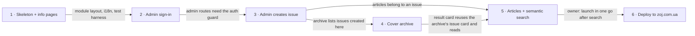

# Roadmap — zsj

> **A decomposition, not a promise.** The overall idea broken into incremental steps: what each
> step is, where it comes from, how big it is — or that nobody has looked at it yet — and in which
> order, and parallel lanes, we walk them. **No dates** (except shipped history), **no scores** —
> order is the prioritization. The *solution* for any step lives in its `docs/features/<slug>/`
> spec, not here.

## Destination

Readers of ЗСЖ in Ukrainian and Russian browse the cover archive on `zoj.com.ua`, find articles by meaning and follow through to subscription, while the admin adds each new issue themselves and its articles become searchable.

## Steps

| # | Step | Source | Size | Status |
|---|---|---|:---:|---|
| 1 | Project skeleton with bilingual layout, language switcher and the Advertising / Subscription info pages (links to external subscription services) — via `/sdd:scaffold` | `docs/architecture-map.md` §Stack; `docs/idea-brief.md` §7 Recommendation | S | built (scaffold) |
| 2 | Admin sign-in: one password, session, `/admin` closed to everyone else → [`features/admin-login/`](features/admin-login/) | `docs/idea-brief.md` §5 Out of scope (password-protected admin) | S | spec'd |
| 3 | Admin creates an Issue (number, month) and its Language editions (UA, RU), each with its cover image | `docs/idea-brief.md` §3 Users (Адмін) | S | idea |
| 4 | Reader browses the cover archive by language and opens an issue page | `docs/idea-brief.md` §7 Recommendation (public part) | S | idea |
| 5 | Article indexing and semantic search: admin uploads a Language edition's Word file, corrects the proposed split, tags every article and publishes; a reader's natural-language query returns excerpt + issue with cover + subscribe call (UA→RU fallback), each article has a public page with similar articles → [`features/article-search/`](features/article-search/) | `docs/idea-brief.md` §2 Problem; §5 Out of scope (search language rule) | L | spec'd |
| 6 | Deploy to `zoj.com.ua`: GitHub Actions builds standalone, applies migrations, ships over SSH, restarts the app's service on the VPS (nginx in front) | `docs/idea-brief.md` §5 Out of scope (domain and hosting); `docs/architecture-map.md` §Constraints & known tech-debt | S | idea |

## Not yet specified

Nothing is in fog: every step can be stated precisely. The unknowns that remain are decisions, listed under Open decisions.

## Out of scope

- Selling or paying for subscriptions on the site — links to external services only (idea brief §5).
- Public full text of articles — readers see an excerpt and the issue (idea brief §5).
- Old-site URL migration, redirects, SEO preservation — the new site launches from scratch (idea brief §5).
- Loading the pre-2026 archive at launch — the admin back-fills it later through step 3 and step 5 (idea brief §5).
- OCR for image-only PDFs — dropped by the owner: issues without a text layer get their text from Word or a manual paste.
- Retaining full issue PDFs on the server — text and cover only (architecture map §Constraints).

## Open decisions

| # | Question | Type | Owner | Blocks |
|---|---|:---:|:---:|:---:|
| D2 | Which webcraft.ua VPS tariff? (HS-300M ruled out 2026-11-26: 300 MB disk; requirements sent to support — 1 vCPU, 1 GB RAM, 10 GB SSD, root SSH) | research | human | 6 |

## Decisions so far

- Next.js + TypeScript single app, deployed standalone on a VPS (amended 2026-11-26: shared tariff too small) → [`ADR-0001`](adr/0001-use-nextjs-typescript-single-app.md)
- Managed PostgreSQL + pgvector via Drizzle → [`ADR-0002`](adr/0002-use-managed-postgres-with-pgvector.md)
- External embeddings API behind an `Embedder` port → [`ADR-0003`](adr/0003-use-external-embeddings-api-behind-port.md)
- Feature modules with domain / application / infra → [`ADR-0004`](adr/0004-organize-code-as-feature-modules.md)
- Ukrainian URLs without a prefix, Russian under `/ru` (supersedes ADR-0005) → [`ADR-0006`](adr/0006-ukrainian-at-root-russian-under-ru.md)
- Store article text and cover only, no PDFs → [`architecture-map.md` §Constraints](architecture-map.md)
- D1 closed 2026-11-27: the 2026 issue PDFs carry a text layer (owner checked) → PDF text is a usable input for step 5
- D3 closed 2026-11-27: the split into articles comes ready-made — the issue's Word file is already divided into articles and carries a table of contents; the system does not propose a split. *Refined 2026-11-27 by the article-search spec: the sample file has no generated table of contents or standard headings, so the site proposes the split from the titles' formatting and the Admin confirms it in a preview.*
- Full article text is public, no embargo — the Admin times publication (owner, 2026-11-27; supersedes brief §5) → [`article-search spec §1`](features/article-search/spec.md)
- D4 closed 2026-11-27: no on-site success metrics in scope; the owner adds Google Analytics to the landing later. The product goal stays qualitative — every page and search result should build the reader's wish to subscribe
- Deploy last, the site launches in one go → owner decision in this roadmap pass; brief → [`idea-brief.md` §5](idea-brief.md)

## Dependency graph

## Execution path

| Wave | Steps | Zone per step (why parallel-safe) | Unlocks |
|:---:|---|---|---|
| 1 | 1 | repo root, `src/app/[locale]/` (new), `messages/` (new) | 2 |
| 2 | 2 | `src/modules/auth/` (new), `src/app/admin/` (new) | 3 |
| 3 | 3 | `src/modules/issues/` (new), `src/modules/ingest/` (new), `src/app/admin/issues/` (new) | 4 |
| 4 | 4 | `src/app/[locale]/archive/` (new), `src/components/` (new) | 5 |
| 5 | 5 | `src/modules/ingest/` (new), `src/modules/search/` (new), `src/shared/embeddings/` (new), `src/app/[locale]/search/` (new) | 6 |
| 6 | 6 | `.github/workflows/` (new) | — |

The path is a single lane: every step builds on the one before. Parallel lanes would only open if step 4 and step 5 were decoupled (the edge between them is a shared UI card, not data), and that is worth revisiting when step 5 is specified.

## Shipped

| Step | Shipped | Link |
|---|---|---|
